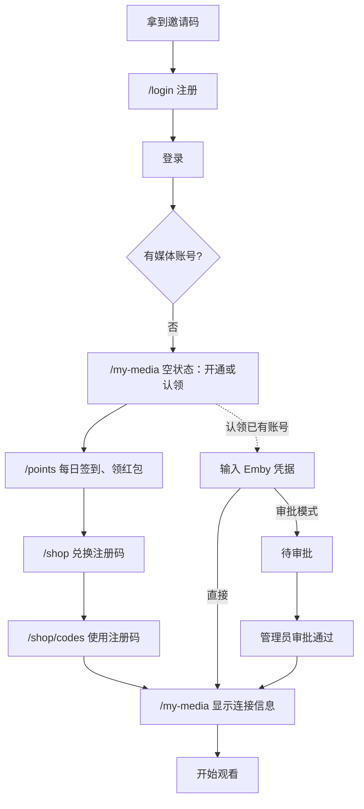
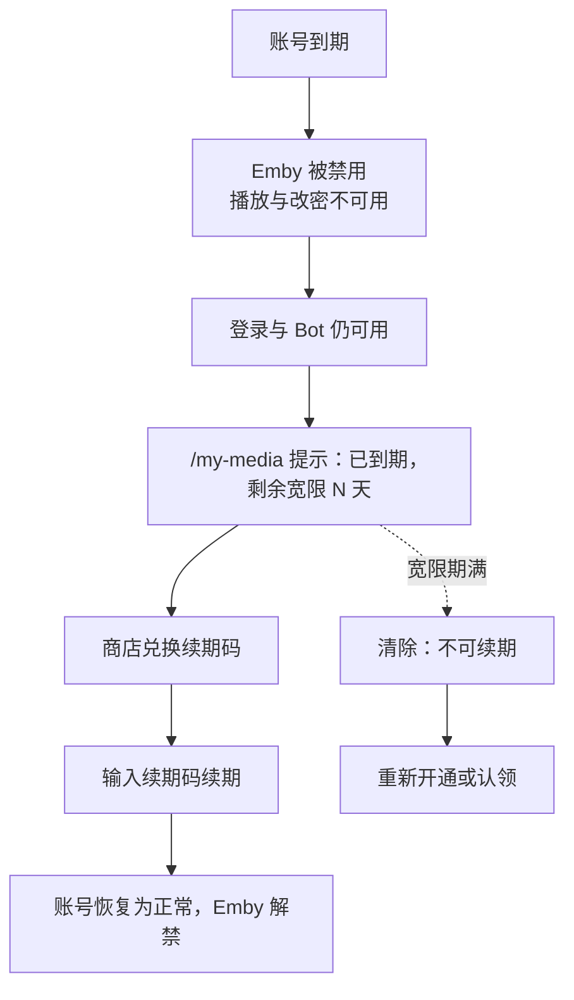
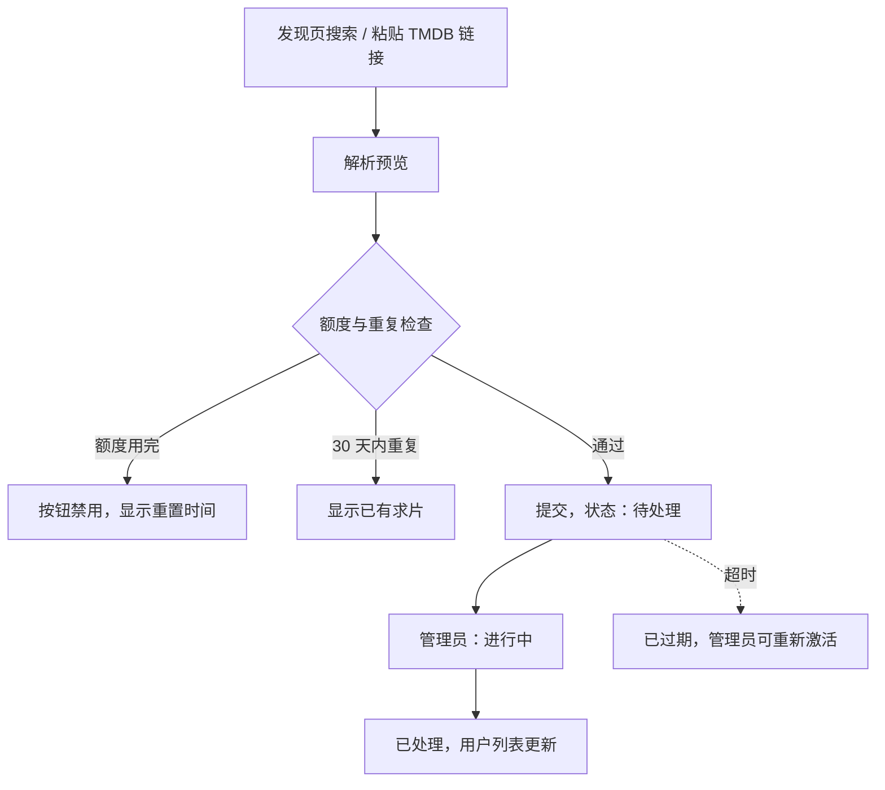
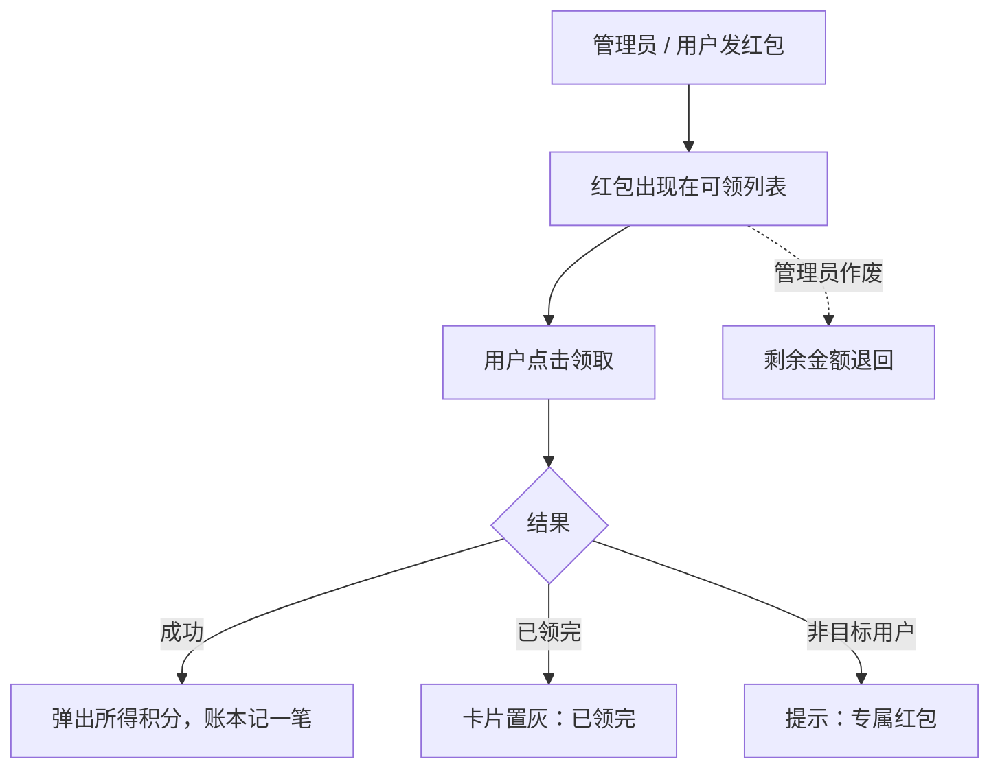
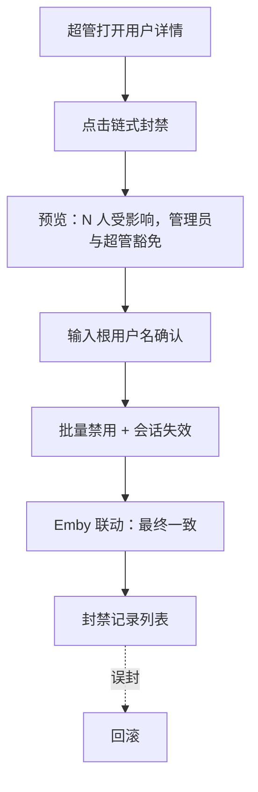
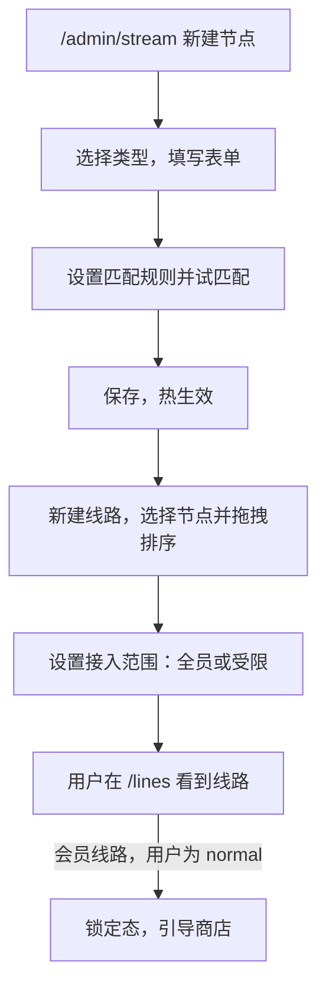

# 关键流程

跨模块的用户旅程。每个流程标出涉及的页面与失败分支。

## F1 新用户开通（积分经济起点）

- 余额不足：商店按钮置灰，提示差额，引导回积分中心。
- 注册码已被使用：显示错误，码状态刷新为“已使用”。
- Emby 创建失败：注册码**不消耗**，提示稍后重试。

## F2 到期自救

## F3 求片

## F4 红包

## F5 链式封禁

## F6 配置一条新线路

