# 导航结构与路由

## 站点地图

```mermaid
flowchart TD
    ROOT["EMS Web"] --> PUB["公开页"]
    ROOT --> SHELL["应用壳（登录后）"]
    PUB --> LOGIN["/login 登录"]
    PUB --> INIT["/initialize 首次初始化"]
    PUB --> STATUS["/service-status 服务状态"]

    SHELL --> PERSONAL["个人区"]
    SHELL --> ADMIN["管理区（admin+）"]
    SHELL --> SYSTEM["系统区（admin+）"]
    SHELL --> SUPER["超管专区（super_admin）"]

    PERSONAL --> P2["搜索结果 /saved-searches"]
    PERSONAL --> P3["求片 /wishes"]
    PERSONAL --> P4["我的媒体 /my-media"]
    PERSONAL --> P5["线路 /lines"]
    PERSONAL --> P6["积分与红包 /points"]
    PERSONAL --> P7["我的商店 /shop"]
    PERSONAL --> P8["个人资料 /profile"]

    ADMIN --> A1["运营仪表盘 /dashboard"]
    ADMIN --> A2["用户管理 /user"]
    ADMIN --> A3["求片处理 /admin/wishes"]
    ADMIN --> A4["商店 · 红包 · 积分"]
    ADMIN --> A5["媒体服务器与账号"]
    ADMIN --> A6["推流节点与线路"]
    ADMIN --> A7["通知 · 计划任务 · 审计"]

    SYSTEM --> S1["系统设置 /setting"]
    SYSTEM --> S2["插件 /plugins"]
    SYSTEM --> S3["宿主机文件 /filemanager"]

    SUPER --> U1["管理员 /super/admins"]
    SUPER --> U2["API Key /super/api-keys"]
    SUPER --> U3["引导配置 /super/bootstrap"]
```

## 侧边菜单分组

| 分组 | 对象 | 备注 |
|---|---|---|
| **个人** | 全部登录用户 | 各项再受层级与功能开关过滤 |
| **管理** | admin、super_admin | 子项按权限点显示；只读项显示“仅查看” |
| **系统** | admin、super_admin | 含只读与超管专属的区块 |
| **超管专区** | super_admin | 对 admin 完全不可见 |

移动端：菜单收起为抽屉；Telegram Mini App 使用独立底部标签（见 [移动端 Mini App](/miniapp)）。

## 路由清单

状态：已实现 / 待实现。读权限为进入页面所需；写权限见各模块页。

### 公开与引导

| 路由 | 页面 | 状态 | 访问 |
|---|---|---|---|
| `/login` | 登录 | 已实现 | 匿名 |
| `/initialize` | 首次初始化 | 已实现 | 仅初始化未完成时 |
| `/service-status` | 服务状态 | 已实现 | 公开就绪信息 |
| `/403` `/404` | 错误页 | 已实现 | — |

### 个人区

| 路由 | 页面 | 状态 | 读权限 / 条件 |
|---|---|---|---|
| `/apps` | 首页 / 应用中心（暂不在菜单展示，样式待调整；移动端“更多”仍可进入） | 已实现 已隐藏 | 已登录 |
| `/credits/:paths+` `/person` `/media` | 影视详情（归属“搜索结果”；发现与音乐已移除） | 已实现 | 已登录 |
| `/saved-searches` | 搜索结果（始终可见；求片按钮由求片开关控制） | 已实现 | 已登录 |
| `/wishes` | 求片 | 待实现 | `wish.self` + 有媒体账号 |
| `/my-media` | 我的媒体账号 | 已实现 | `media.self` |
| `/lines` | 线路 | 已实现 | `line.select` |
| `/points` | 积分中心(余额、签到、时间线) | 已实现 | `points.self` + 积分开关 |
| `/points/red-packets` | 红包(可领与发红包) | 已实现 | `points.self` + 红包开关 |
| `/points/red-packets/history` | 红包记录(我发的 / 我领的) | 已实现 | `points.self` + 红包开关 |
| `/shop` | 我的商店 | 已实现 | `shop.self` + 商店开关 + 积分开关 |
| `/vouchers` | 卡券中心(旧 `/shop/cards` 跳转) | 已实现 | `shop.self` + (商店开关 或 持有礼品卡) |
| `/profile` | 个人资料与安全 | 已实现 | 已登录 |

::: warning 路由冲突
现有 `/media` 是“发现”的媒体详情页，因此“我的媒体账号”使用 `/my-media`。
:::

### 管理区

| 路由 | 页面 | 状态 | 读权限 |
|---|---|---|---|
| `/dashboard` | 运营仪表盘（敏感内容，仅管理员） | 已实现 | `admin.system.read` / `admin.streams.watch` |
| `/user` | 用户管理 | 已实现 | `admin.users.read` |
| `/admin/users/:id/tree` | 邀请树 | 待实现 | `admin.users.read` |
| `/admin/wishes` | 求片处理 | 待实现 | `admin.wish.write` |
| `/admin/products` | 商品管理(旧 `/admin/shop` 跳转) | 已实现 | `admin.shop.write` |
| `/admin/vouchers` | 卡券管理 | 已实现 | `admin.shop.write`;查看卡号:`admin.shop.reveal`(授权) |
| `/admin/red-packets` | 红包管理(策略、发行、记录、作废) | 已实现 | `admin.redpacket.read`;写:`admin.redpacket.write`;策略:`admin.redpacket.config` |
| `/admin/checkin` | 签到设置(默认区间、分组规则、试算) | 已实现 | `admin.checkin.read`;写:`admin.checkin.write` |
| `/admin/points` | 积分调整、对账与系统账户 | 已实现 | `admin.points.adjust` 或 `admin.points.read` |
| `/admin/groups` | 访问分组 | 已实现 | `admin.groups.read`；写入 `admin.groups.write` |
| `/admin/media-servers` | 媒体服务器 | 已实现 | `admin.config.media` |
| `/admin/media-accounts` | 媒体账号管理 | 待实现 | `admin.media.write` |
| `/admin/stream/nodes` | 推流节点(含健康状态) | 已实现 | `admin.config.media`;部署需具备前端网关 |
| `/admin/stream/lines` | 推流线路 | 已实现 | `admin.config.media`;部署需具备前端网关 |
| `/admin/notify` | 通知与 Bot | 待实现 | `admin.notify.write` |
| `/admin/scheduler` | 计划任务 | 待实现 | `admin.scheduler.read` |
| `/admin/audit` | 审计日志 | 待实现 | `admin.audit.read` |

### 系统区与超管专区

| 路由 | 页面 | 状态 | 读权限 |
|---|---|---|---|
| `/setting` | 系统设置 | 已实现 | `admin.config.write` |
| `/plugins` | 插件 | 已实现 | admin |
| `/filemanager` | 宿主机文件 | 已实现 | `admin.files.read`；写入 `super.files.write` |
| `/openapi` | OpenAPI 文档（内置页面，仅管理员） | 已实现 | `admin.system.read` |
| `/super/admins` | 管理员管理 | 已实现 | `super.admins.write` |
| `/super/api-keys` | API Key | 已实现 | `super.apikeys.write` |
| `/super/bootstrap` | 引导配置（只读脱敏） | 已实现 | `super.bootstrap.read` |

## 登录后落地页

登录后管理员进入 `/dashboard`，持有 `media.self` 的成员进入 `/my-media`，其余进入 `/saved-searches`。若请求带有原目标路径，优先回到该路径。

## 路由守卫顺序

1. 初始化未完成 → 跳转 `/initialize`。
2. 未登录 → `/login?redirect=原路径`。
3. 用户被管理员禁用 → 强制登出并提示；**媒体账号状态不触发登出**。
4. 缺少页面读权限 → `/403`。
5. 功能开关关闭 → 菜单隐藏，直接访问 `/404`。
