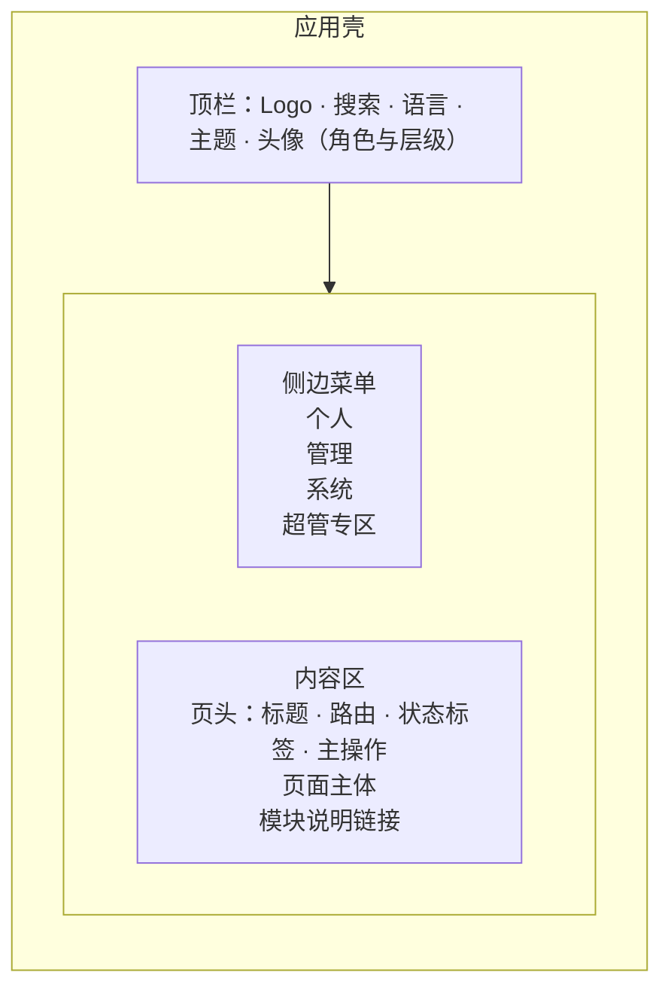

# 界面草图

这是**布局与流程草图**，不是视觉设计：用来确认侧边菜单的分组、各角色看到的入口、以及页面里“可操作 / 仅查看”的差别。灰色方块只是内容占位。

## 整体布局

| 区域 | 规则 |
|---|---|
| 顶栏 | 全局搜索、语言、主题、头像菜单（资料、退出）；头像旁显示角色与层级标签 |
| 侧边菜单 | 四个分组，**只显示当前身份有读权限的项**；分组内没有可见项时整组隐藏 |
| 菜单项标记 | 👁 表示仅查看；锁定的功能保留在原处并带锁图标 |
| 页头 | 标题、路由、状态标签（仅查看）、主操作按钮；无写权限时主操作不渲染 |
| 手机 | 菜单收进左侧抽屉；表格转为卡片列表；Mini App 使用底部标签 |

## 可点击草图

选择身份，点击左侧菜单项，查看该页面的大致布局。切到“手机”可看抽屉菜单。

<ShellWireframe />

## 观察要点

1. **normal 用户**菜单只有“个人”分组；切换到 vip，会员线路变为可选。
2. **管理员**多出“管理”“系统”分组；“运营仪表盘”“审计日志”等只读页面带 👁，页头出现“仅查看”，没有新建按钮。
3. **超级管理员**多出“超管专区”；宿主机文件出现重命名、删除；邀请树页出现链式封禁入口。
4. 所有页面底部都有该模块完整说明的链接，用于回到功能描述。
